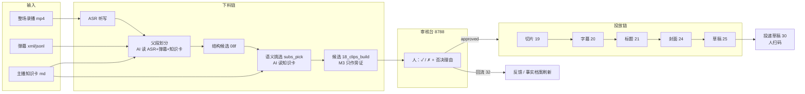
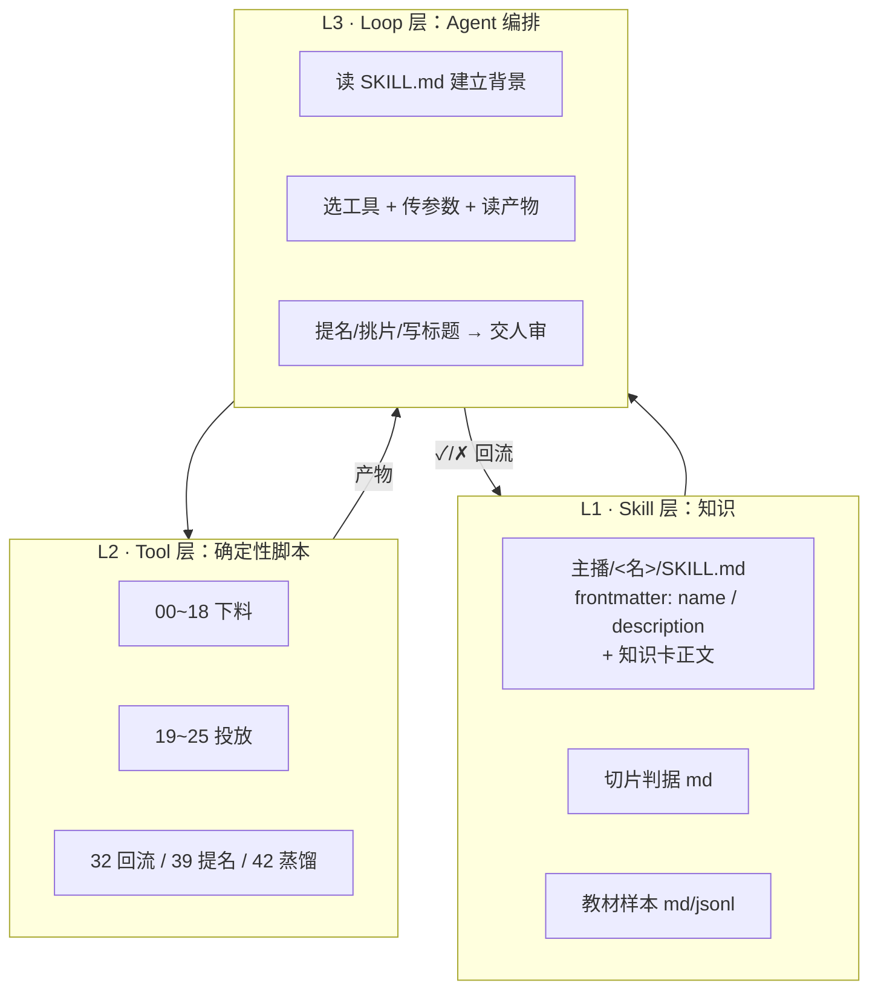

# autocut · 直播切片 Agent

把一场直播录播（整场视频 + 弹幕）切成「对标职业切片员质量」的成片，产出到**投稿草稿**为止。
**AI 只提名，人拍板** —— 机器负责候选、成片、字幕、标题、封面，人只在审核台按 ✓/✗ 并点公开。

> 当前状态（2026-11-18）：**单场闭环已真机跑通一次**（人审通过率 75%，n=12），
> 正在从「脚本流水线」升级为「**主播知识驱动的 Agent 项目**」。

---

## 目录

- [一句话与边界](#一句话与边界)
- [当前进度（实数）](#当前进度实数)
- [里程碑时间线](#里程碑时间线)
- [系统架构](#系统架构)
- [流程复盘：过往是怎么跑过来的](#流程复盘过往是怎么跑过来的)
- [主播知识卡：把主播蒸馏成 md（v1 已落地）](#主播知识卡把主播蒸馏成-mdv1-已落地)
- [后续路线：Agent 化（v2）](#后续路线agent-化v2)
- [快速开始](#快速开始)
- [质量口径](#质量口径)
- [关键决策（ADR）](#关键决策adr)
- [目录结构](#目录结构)
- [已知缺陷](#已知缺陷)
- [红线](#红线)

---

## 一句话与边界

| | |
|---|---|
| **输入** | 每场直播的**整场视频（一个文件）** + 同场弹幕（xml/jsonl） |
| **中间产物** | 主播知识卡 → 父段（话题）→ 候选（提名）→ 成片 + 字幕 + 标题 + 封面 |
| **输出** | 投稿**草稿**（不自动公开） |
| **人做什么** | 审核台按 ✓/✗、点公开；划父段/标题由 AI 出、人抽查 |
| **不做** | 全场文字概括 · 视觉参与切片判断（视觉只做封面）· 竖屏重构 · 多平台分发 · 本地训模型 · 真·实时分析 |

---

## 当前进度（实数）

**闭环（10-09 场，2026-10-21 走完）**

| 环节 | 结果 |
|---|---|
| 下料链 | 14 步：13 ok / 1 warn（可选 SC）/ 0 fail；全场 2h37m，ASR 11 min |
| 父段 → 候选 | 35 父段 → **12 条候选 / 覆盖 39.1%**（修「全切」前是 34 条 / 100%） |
| 人审 | **9 ✓ / 3 ✗ ⇒ 通过率 75%**（`review_log.jsonl` 12 条齐全，回读一致） |
| 投放链 | 9 步全 ok；clip / ass / cover / title **各 9/9**；草稿 9 个 + `_index.md` |
| 成片体量 | 合计 36.6 min，中位 208 s |
| 3 条否决 | 全是同一句：**「不要唱歌舞蹈」** ⇒ 唱/舞段应在划父段时就标 `no_clip` |

**累计人审**（本机已审 4 场）：58 条，✓ 44 / ✗ 14 ⇒ **75.9%**

**还差一步（纯人工、红线）**：装 `biliup-rs` + 手机扫码 → 投**草稿**。公开永远留给人。

---

## 里程碑时间线

| 日期 | 发生了什么 |
|---|---|
| 09-14 | 项目起步：先量数据（切片员样本、弹幕密度、语音密度），再谈算法 |
| 09-24 | 首场端到端：27 候选（18✓/9✗）→ 18 条成片 73 min，4 件产物齐全 |
| 09-27 | 用户定：**唱歌/舞蹈段不出片**；录制口径=整场一文件、录完再分析 |
| 09-30 | 除录制外全链封成**门户网页端**（下料台 / 审核台 / 投放台），`pipeline.py` 成为链路唯一定义 |
| 10-01 | 投递环落地：`30_publish` 只投草稿 + `31_poll_status` 只读查过审 |
| 10-02 | 真值来源改判：**审核台 ✓/✗ 回流**才是真值，不是离线标注集；`32_review_feedback` 只读回流 |
| 10-07 | **取消 `75/15/10` 时长比例规范**（易诱导凑比例）；路线拍板：不开新仓、就在本仓库继续开发（ADR-0003） |
| 10-09 | 换主判据：**LLM 读 ASR 语义提名**，判据落成数据文件（ADR-0005）；项目对准、范围冻结（ADR-0006） |
| 10-14 | 拆掉 7 个数值门禁（`SUB_MAX=300` 等）；给两条链补 AI 环节，链不再断在 AI 处 |
| 10-21 | 修「整段录播全被切片」根因（缺 `subs_pick` 语义挑选）；同场闭环走完，**75%** |
| 11-18 | **主播知识卡 v1**：`42_streamer_profile.py` + 链上 ④a 注入 + 审核后刷新事实档案；本 README |

---

## 系统架构



**两个入口，同一份链路定义**

- 网页端：`验证/portal/启动门户.bat`（下料台 / 审核台 / 投放台）
- 命令行：`验证/portal/pipeline.py` 是「什么脚本按什么顺序跑」的**唯一出处**，页面不自己拼命令

**两段式惯例**（所有 AI 环节）：`--emit` 产 prompt → AI 写 `raw.json` → `--apply` 落盘。
门户里 AI 环节是 `Step(ai=...)`：配了密钥就直调 API，否则**阻塞等 raw.json**（就绪判据 = `raw mtime ≥ prompt mtime`，旧答案不会被误用）。

---

## 流程复盘：过往是怎么跑过来的

这一节回答三个问题：**现行流程每一步干什么**、**人到底要动几次手**、**哪些坑已经踩过别再踩**。
所有步骤顺序都来自 `验证/portal/pipeline.py`（它不是文档，是唯一出处）。

### 一、形态变化（为什么流程长成现在这样）

| 阶段 | 形态 | 为什么会变成这样 |
|---|---|---|
| 09-14 ~ 09-23 | 一堆独立脚本，手工按顺序跑 | 先在量数据（切片员样本、弹幕密度、语音密度），还没资格谈流水线 |
| 09-30 | **门户三台**（下料/审核/投放），`pipeline.py` 统一定义链 | 手工点 20 个脚本不可持续；页面自己拼命令 ⇒ 两处维护 |
| 10-14 | **AI 环节进链**（`Step(ai=...)`，两段式） | 链原来断在"该 AI 出结果"的地方：没人被告知要写哪个文件 |
| 10-21 | **候选不再是父段枚举**（加 `subs_pick` 语义挑选） | 34 父段 → 34 条候选，覆盖 100%，那不是提名是"全切" |
| 11-18 | **主播知识卡前置注入** | 只喂 ASR/弹幕/SC ⇒ AI 不知道"这人是谁、粉丝叫小星星、纯唱不出片" |

### 二、链 1 · 下料（素材 → `clips.json`，现行 17 步）

| # | 步骤 | 命令 / 脚本 | 产物 | 人参与 |
|---|---|---|---|---|
| ① | 扫描素材 · 拼弹幕累加轴 | `08_prep` | `danmaku.jsonl`、`segments.json`、`source_meta.json` | — |
| ② | 抽音频 · 多段拼 16k 单声道 | `08b_audio` | `work/audio.wav` | — |
| ③ | **ASR 整场**· 逐词时间戳 | `make_reasons --dump-ts`（**必须用 `验证/venv`**） | `03_asr_tokens.jsonl` | — |
| ③b | 特征层：M2 五条 + M3 打分 | `02_m2m3`（多场必传 `--match`） | `02_m2m3.json` | — |
| ④ | 话题分段输入 | `08c_topic_input` | `08_llm_input.txt` | — |
| ④a | **主播知识卡解析 + 注入** | `42_streamer_profile --inject` | `主播画像.md` + 幂等前缀 | —（没建卡则 warn） |
| ④b | **AI 环节 · 划父段** | AI 读整场 ASR → `topics_src.json` | `topics_src.json` | ⭐ 人抽查/改（唱舞段标 `no_clip`） |
| ⑤ | 话题分段落盘 | `08d_topics_build` | `08_topics.json` | — |
| ⑥ | M3 弹幕峰提名 | `08e_m3_candidates` | `m3_candidates.json` | — |
| ⑥b | SC 内容信号（可选） | `09c_sc_signal` | — | — |
| ⑦ | A 路结构切分 | `08f_subs_cut --auto` | `08_subs_candidates.json` | — |
| ⑦a | A 路挑选 · **播种子段清单** | `08f_subs_cut --emit` | `subs_src.json`（不播种 ⇒ ⑦c 回退"全 pick"） | — |
| ⑦b | **AI 环节 · 语义挑选** | AI 只留值得出片的（`strict`：必须本步之后被改写） | `subs_src.json` 的 `pick` | ⭐ 人可改 |
| ⑦c | A 路写回 | `08f_subs_cut --apply` | 只写 `pick=true` | — |
| ⑧ | B 路段内取片 | `11_seg_peaks` | `11_subpeaks.json` | — |
| ⑨ | B 路（语音信号版） | `11b` | `11_subpeaks_asr.json` | — |
| ⑩ | 中枢：生成候选 | `18_clips_build --a-sub-only` | **`clips.json`** | — |

> ⭐ ⑩ 的 `--a-sub-only` 是硬要求：M3/B 路只作证据与旁证，**不独立成候选**，且边界回正到 A 路单元。
> 否则被砍掉的话题会被弹幕峰"复活"（实测 34→12 条后又反弹到 26 条、覆盖 39.1%→59.6%）。

### 三、链 1b · 审核原片（审核的前置，不是可选）

| 步骤 | 命令 | 为什么必须 |
|---|---|---|
| 原片转 mp4（统一 → concat） | `19_render --make-source --unify` | 素材多段异构（1080p/720p、FLV/MP4 混时间基）⇒ 直接 concat 会拒绝或把时长放大 15.36 倍 |

### 四、链 2 · 审核（人在这一环，机器只等）

- 审核台是**独立服务 8788**（`22_review_server.py`），**不是门户的一条路由**。
  门户 `server.py` 按当前场次自动起停它，`/api/bootstrap` 返回 `review_url`。
- 通过 = 回车直接记；否决 = 按 `x` 弹理由选择器（`review_reasons.json` 9 项，**未确认不落盘**）。
- 落盘：`review_log.jsonl`（含 `snap` 特征快照）+ `clips.json` 的 `review.status`，两处必须回读一致。

### 五、链 2b · 回流（审核完立刻跑）

| 步骤 | 命令 | 产物 | 用途 |
|---|---|---|---|
| 审核回流导出 | `32_review_feedback`（只读） | `32_review_feedback.md` | 贴进会话，让 AI 据此改**数据文件**（不改算法） |
| 刷新主播卡事实档案 | `42_streamer_profile --stats` | `主播/<名>.md` 的自动段 | 只记 ✓/✗ 统计，**禁止当判据** |

### 六、链 3 · 投放（成片 → 草稿，9 步）

| # | 步骤 | 命令 | 产物 |
|---|---|---|---|
| ① | 切片 | `19_render --all-approved` | `clip.mp4` |
| ② | 字幕 | `20_subtitle --all-approved` | `clip.ass` |
| ③ → ③b → ④ | 标题 prompt → **AI 写标题** → 写回 | `21_title --emit` / AI / `--apply` | `title.final` |
| ⑤ → ⑤b → ⑥ | 封面 prompt → **AI 写文案** → 出图 | `24_cover --emit` / AI / `--apply` | `cover.jpg` + `cover_report.json` |
| ⑦ | 草稿包 | `25_draft --all-approved` | `drafts/_index.md` + 每条草稿 |

> 每步跑完都做**产物核对**（查 `Step.produces` 的文件是否真存在），防"静默成功"。

### 七、链 4 · 投递（3 步，最后一步是人）

| 步骤 | 命令 | 边界 |
|---|---|---|
| ① 干跑计划 | `30_publish --dry-run` | 只打印要投什么 |
| ② 真投**草稿** | `30_publish` | ⛔ 永不自动公开 |
| ③ 查过审 | `31_poll_status`（只读） | 轮询状态，不改任何东西 |

链 5 · 单条重做：改完边界/标题后只重跑这一条（`19 --clip` → `20` → `21` → `24` → `25`），不用重跑全场。

### 八、人的动作只有 3 处

| # | 人的动作 | 频率 | 为什么不能交给机器 |
|---|---|---|---|
| 1 | 抽查/改两个数据文件：`topics_src.json`（父段）、`subs_src.json`（`pick`） | 每场 | 判断落成数据文件；脚本只执行不猜 |
| 2 | 审核台按 ✓/✗ + 否决理由 | 每场 | "这条要不要发"只能人拍板 |
| 3 | 扫码投递 / 点公开 | 每批 | 红线：不自动公开 |

其余（划父段、选片、标题、封面、渲染、限速、打包）全由脚本 + AI 完成。

### 九、一次实跑的成本（10-09 场，2h37m 素材）

| 项 | 实测 |
|---|---|
| ASR 整场 | **11 min**（早期 14 min） |
| 人工停等 | 2 次：④b 划父段、⑦b 挑选（各写一个 raw/数据文件） |
| 投放链 | 9 步分钟级；单条切片 1.6~3.1 s（`-c copy`） |
| 审核 | 12 条，人的时间才是真瓶颈 |

### 十、已经踩过的流程坑（别再来一次）

| 坑 | 症状 | 现在的做法 |
|---|---|---|
| 链断在 AI 环节 | ④b/③b/⑤b 原本不存在 ⇒ 下一步必缺文件 | `Step(ai=...)`，手工模式**阻塞等** `raw.json` |
| raw 太旧被当答案 | AI 一步没做就"秒过" | 就绪判据 = `raw mtime ≥ prompt mtime`；同文件场景用 `strict` |
| 审核台挂在门户 `/review` | 「缺 source.mp4」、✓/✗ **静默丢裁决** | 独立服务 8788 + 门户自动起停 |
| 全切 | 34 父段 = 34 条候选、覆盖 100% | `subs_src.json` 播种 + ⑦b 语义挑选 + `--a-sub-only` |
| 重建清空派生字段 | 重跑 18 就丢人工标注 | `18_clips_build --keep-derived`（默认开） |
| 素材异构 concat | 拒绝拼接 / 时长 ×15.36 | `--unify` 统一**所有**段（含 `time_base`） |
| 封面静默不出图 | `24_cover --apply` 只写文本就返回 | 现在写回后继续出图 + `cover_report.json` 供核对 |
| 数值门禁从下游扳回因果 | `SUB_MAX=300` 等把时长偷偷变成原因 | 7 个常量已拆（10-14），唯一行为=一个父段一个单元 |

---

## 主播知识卡：把主播蒸馏成 md（v1 已落地）

### 为什么

切片判断不是"纯看这一段话"。同一句话，懂这位主播的人看是梗，不懂的人看是废话。
原来喂给 AI 的只有 ASR / 弹幕 / SC，缺的正是**主播这一层常识**：
他是谁、粉丝怎么称呼、有哪些常驻栏目、哪些内容他自己和观众都不爱。

### 怎么落地

把主播知识**落成数据文件** `主播/<主播名>.md`，让每个 AI 环节像读 skill 一样读它 ——
与弹幕、SC、ASR **并列作为分析输入**，而不是塞进代码里的 `if` 分支。

```
主播/
├── _active.json      # {"anchor": "星瞳"} —— 当前主用主播
└── 星瞳.md           # 知识卡（AI 蒸馏 + 人可手改）
```

卡片固定小节（顺序即渲染顺序，AI 多给的键会被忽略）：

| 小节 | 内容 |
|---|---|
| 身份与称呼 | 他是谁、自称、**粉丝怎么称呼他** |
| 观众与互动 | 观众构成、互动通道（弹幕/SC/连麦）、态度与口癖 |
| 常驻栏目与桥段 | 反复出现的固定环节（判断"这段是不是某栏目的一环"） |
| 梗与世界观 | 圈内梗、黑话、与其他主播的关系（不懂就会误判成废话） |
| 出片偏好 | **要**什么；**不要**什么（纯唱/纯舞 ⇒ 划父段就标 `no_clip`） |
| 语言特征 | 口头禅、语速停顿、方言、笑点触发方式（供 ASR 纠错与标题用词） |
| 事实档案（自动） | ✓/✗ 场次统计，**明确禁止当判据**，只为观察 |
| `MANUAL:` 人工区 | 人写的内容，重蒸馏时**原样保留** |

### 脚本

`验证/42_streamer_profile.py` —— 六种模式，全部可单独跑：

| 模式 | 作用 |
|---|---|
| `--emit` | 产出蒸馏 prompt（读本场 ASR 摘录 + 审核回流 + 切片员样本标题） |
| `--apply` | 消费 `profile_raw.json` → 渲染 `主播/<名>.md`（保留人工区） |
| `--inject` | 写 `{out}/主播画像.md` + **幂等前缀**进 `08_llm_input.txt`（划父段 prompt） |
| `--stats` | 只刷新「事实档案」（审核回流后跑，不碰 AI 小节与人工区） |
| `--check` | 结构 + 数字判据自检，违规 `rc=1`（可当门禁） |
| `--show` | 打印解析到哪张卡 + 卡片正文 |

```bash
PY="C:/Users/zyc/.workbuddy/binaries/python/versions/3.13.12/python.exe"
$PY 验证/42_streamer_profile.py --out 验证/out_1009 --emit     # ① 产 prompt
#   … AI 写 验证/out_1009/profile_raw.json …
$PY 验证/42_streamer_profile.py --out 验证/out_1009 --apply    # ② 渲染 md
$PY 验证/42_streamer_profile.py --out 验证/out_1009 --inject   # ③ 注入本场链路
$PY 验证/42_streamer_profile.py --out 验证/out_1009 --check    # ④ 自检
```

### 已接入的位置（v1 的真实覆盖面）

| 环节 | 是否读知识卡 | 怎么读 |
|---|---|---|
| ④b 划父段（AI） | ✅ | `--inject` 把背景**前缀**进 `08_llm_input.txt` |
| ⑦b subs_pick（AI 语义挑选） | ✅ | `llm._profile_block()` 读 `{out}/主播画像.md` |
| `39_nominate`（提名对照链） | ✅ | `--profile auto` → `{out}/主播画像.md` |
| ③b 标题 / ⑤b 封面 | ⏳ **未接** | 见 [v2](#后续路线agent-化v2) |
| 审核回流 | ✅ | `profile_stats` 步刷新事实档案（只统计，不当判据） |

### 三条铁律

1. ⛔ **卡里不能有数值判据**（时长/条数/阈值）。"事实档案"由脚本生成并**明确标注禁止当判据**；判据小节写数字 ⇒ `--check` 退出 1，`--inject` 拒绝注入。
2. ⭐ **判断落成数据文件**：人要改就直接改 md；重蒸馏只覆盖 AI 小节。
3. ⛔ **不写死主播名**：解析顺序 `--anchor` > `clips.json._meta.anchor` > `主播/_active.json`；解析不到**明确报错**，不猜、不造空卡。

---

## 后续路线：Agent 化（v2）

### 定位变化

v1 是「脚本流水线 + 人点门户」；v2 是「**Agent 项目**」：
主播知识以 md 形式存在（像 skill 一样可读、可改、可审），Agent 在**决策点**读它、调工具、交人拍板。



**为什么这样切**：工具层（脚本）已经稳定且可复跑，不该重写；变化的是**判断依据**——
把"这个人是谁"从代码常量里搬到 md，是 ADR-0006「新增范围必须能落成数据文件」的直接延伸。

### 任务清单（带状态，`⏳` 为待做）

| # | 任务 | 状态 | 验收 |
|---|---|---|---|
| 1 | 知识卡 v1：单主播、单文件、手改保留、6 种模式 | ✅ 11-18 | `--check` rc=0；`--inject` 后 ④b 读到背景 |
| 2 | **注入面扩到标题/封面**（称谓、口癖、梗用词） | ⏳ | `run_title`/`run_cover` 带上 `_profile_block`，标题称谓不再写错（如「大哥」） |
| 3 | **`--check` 当链上门禁**：现在是 warn，改为 ④a 失败即拦 | ⏳ | 卡里有数字 ⇒ 链停，而不是继续跑 |
| 4 | **审核否决 → 写回卡片「待确认」节** | ⏳ | ✗ 理由聚类进 `## 待确认`，人确认后才升为规则（不自动改判据） |
| 5 | **多主播支持**：`主播/<名>/` 目录化 + 场次→主播映射 | ⏳ | 新主播不用改代码；`_active.json` 可切 |
| 6 | **skill 化**：`主播/<名>/SKILL.md`（frontmatter `name/description`） | ⏳ | 外部 agent 可直接按 skill 加载（含"何时该用这张卡"的 description） |
| 7 | **Agent 编排层**：plan → tool calls → 交人审 | ⏳ | 一句话跑完下料链，AI 环节不再靠人贴 raw.json |
| 8 | **证据可追溯**：卡里每条断言指回场次/条目 | ⏳ | 每个论断后有 `（out_1009 / S1009-960）` 式来源 |

### 分阶段

- **v2.1 打通注入面（任务 2、3）**：最小改动、直接拉标题/封面质量，且不新增判据。
- **v2.2 让卡片会学习（任务 4、5、8）**：反馈闭环，但"人确认才升规则"是硬约束 —— 自动改判据等于把偏好变成过拟合。
- **v2.3 Agent 化（任务 6、7）**：skill 化 + 编排层，目标是把"人点门户"缩到"人只看 ✓/✗"。

### 明确不做的（避免范围再次膨胀）

- ⛔ 自动公开投稿（红线）
- ⛔ 多账号池/轮换（违规，不能当扩容手段）
- ⛔ 训练模型（数据量差 40~400 倍，本机 2GB 显存训不动）
- ⛔ 让知识卡承担数值判据（时长永远由内容决定）

---

## 快速开始

```bash
# 环境：Windows + Git Bash + Python
PY="C:/Users/zyc/.workbuddy/binaries/python/versions/3.13.12/python.exe"   # 受管 Python
# ASR 必须用 venv（受管 Python 没装 sherpa_onnx）
PY_ASR="验证/venv/Scripts/python.exe"

# 网页端（推荐）
验证/portal/启动门户.bat          # :8790 门户；审核台自动起在 :8788

# 无头跑一条链（下料 / 投放）
$PY 验证/portal/pipeline.py --list
```

**换一场新素材**（手工链路）：

```bash
$PY 验证/08_prep.py ...            # 素材整理（多场时 02_m2m3.py 必传 --match）
$PY 验证/08b_audio.py ...
$PY_ASR 验证/make_reasons.py --dump-ts   # 时间戳
#   手写 topics_src.json（父段；唱/舞段标 no_clip=true）
$PY 验证/08c_topics_input.py ...   # 拼划父段 prompt（含知识卡注入）
$PY 验证/08d_topics_build.py ...
$PY 验证/08f_subs_cut.py --emit && $PY 验证/08f_subs_cut.py --apply
$PY 验证/18_clips_build.py --out ... --a-sub-only
```

**注入主播知识卡**：

```bash
$PY 验证/42_streamer_profile.py --out 验证/out_1009 --emit   # → AI 写 profile_raw.json
$PY 验证/42_streamer_profile.py --out 验证/out_1009 --apply --inject
```

> 探活本机服务一律 `curl --noproxy '*'`（有残留代理，连本机也会 502）。
> 常驻服务要用后台任务起，且**活不过会话轮次** ⇒ 要让用户审，得自己双击 `启动门户.bat`。

---

## 质量口径

| 指标 | 定义 | 说明 |
|---|---|---|
| **人审通过率**（主指标） | ✓ ÷ (✓+✗) | 来源 `out_*/review_log.jsonl` |
| 真召回 | 切片员发过片的场里，其内容被我们命中的比例 | 真值 = `投稿样本/clippers/`（1328 条） |
| 覆盖率 | 提名时长 ÷ 整场时长 | 单独报没有意义 |
| **效率** | 真召回 ÷ 覆盖率 | 否则"整场提名"就能拿 100% 召回 |

- ⛔ **算不出精确率/误报率**：切片员样本只是**正样本集合**，不要算 F1。
- ⛔ **成片时长无任何比例规范**（`75/15/10` 已于 10-07 取消）。时长只由粒度判据决定。
  仍有效：>8 min 需说明理由 / 18 min 软上限（先试拆）/ 硬顶 30 min。
- ⛔ **对齐度不再是闸**（ADR-0006），只作观察统计。
- ⚠️ 任何 A/B 必须**≥3 次重复**：同一 prompt 跑 3 次，召回极差曾达 52pp。

---

## 关键决策（ADR）

| ADR | 决定 |
|---|---|
| [0002](docs/adr/0002-取消成片时长比例规范.md) | 取消成片时长比例规范（`75/15/10`），时长只由内容粒度决定 |
| [0003](docs/adr/0003-旧仓继续开发采纳Matt纪律.md) | 在旧仓继续开发、不开新仓；采纳 ADR 纪律 |
| [0004](docs/adr/0004-切片判据因果方向改为内容决定时长.md) | 因果方向改为「内容决定时长」，堵住时长从下游扳回因果 |
| [0005](docs/adr/0005-核心切片判据换为LLM语义提名.md) | 核心判据换成 LLM 语义提名（判据落成数据文件） |
| [0006](docs/adr/0006-项目对准-终点是工具-冻结范围-换主判据.md) | 终点是成品工具；冻结范围；主指标换成通过率；划父段/标题交 AI |
| — （待补） | 主播知识卡：把主播蒸馏成 md 作为分析输入（本文档 v1 已实现） |

---

## 目录结构

```
AGENTS.md                 # 常驻约束（每个会话先读）
CONTEXT.md                # 名词表
docs/adr/                 # 难以回退的决定
项目文档/
├── 项目地图.md           # ⭐ 现状地图 + 名词表 + 现在卡在哪
├── 终稿.md               # 权威设计（结论/红线/口径）
├── 标题规律_实测.md      # 1430 条 / 9 位切片员，可复跑
└── 优化清单_20261002.md  # 已量化但故意未修的缺陷
主播/
├── _active.json          # 当前主用主播
└── <主播名>.md           # 主播知识卡（v1）
验证/
├── 00~42_*.py            # 全链脚本
├── portal/               # 网页端（pipeline.py 是链唯一出处）
└── out_*/                # 各场产物（clips.json / review_log.jsonl / drafts/）
投稿样本/clippers/        # 切片员真值样本 1328 条
```

---

## 已知缺陷

| 缺陷 | 影响 | 状态 |
|---|---|---|
| `18_clips_build` 合并时 `sorted(hit['sources'])` 打乱优先级 | 非 `--a-sub-only` 路径下 M3 宽边界会赢，候选被往左拉 30~90 s | `--a-sub-only` 已回正；通用路径未改 |
| 知识卡只注入 3 个环节 | 标题/封面仍可能用错称谓、漏梗 | v2 任务 2 |
| `--check` 只是 warn | 带数字判据的卡可能被注入 | v2 任务 3 |
| 审核回流只更新统计 | ✗ 的理由没有回到卡片 | v2 任务 4 |
| 通过率 n=12（单场） | 75% 可能是运气 | 需再跑 1~2 场扩到 n≈40 |

---

## 红线

- **只投草稿/待审，绝不自动公开**
- **单账号**；⛔ 禁止多账号池 / 账号轮换
- 投稿字段长度等硬约束以官方最新条款为准，复核后写死在代码里
- 录制不使用主账号凭证；**素材根下任何配置文件禁读**（配置只能由人口述）
- 媒体、模型、凭证**不进 git**
